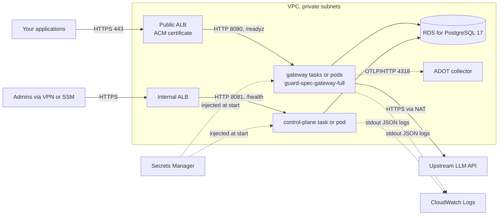

<!-- Copyright 2026 The Guard Spec Authors -->
<!-- SPDX-License-Identifier: Apache-2.0 -->

# Deploying on AWS

> **Status: reference template, not yet verified by the maintainers.**
> Community-tested: not yet. If you deploy this, please open an
> [issue](https://github.com/guard-spec/guard-spec/issues/new/choose) or a pull
> request with what worked and what did not. See
> [CONTRIBUTING.md](../../CONTRIBUTING.md) and the [index](README.md).

Two ways to run the services, same database and secrets:

- **A. ECS on Fargate**: no cluster to run. Uses the `gateway-full` image,
  so no shared model volume.
- **B. EKS**: the Helm chart in `deploy/helm/guard-spec`, following the
  [Kubernetes steps](on-premise.md#2-kubernetes) with AWS pieces swapped in.

The CLI and JSON below are templates: placeholders such as `<your-db-host>`,
`<region>` and `<account-id>` must be filled in, and nothing here was run
against a real AWS account.

## Architecture



| Need | AWS service |
|---|---|
| Compute | ECS on Fargate, or EKS |
| Database | RDS for PostgreSQL 17, private, encrypted, TLS enforced |
| Secrets | Secrets Manager |
| TLS and routing | Application Load Balancer with an ACM certificate; a second, internal ALB for the control plane |
| Logs | CloudWatch Logs (`awslogs` on ECS; the CloudWatch Observability add-on or Fluent Bit on EKS) |
| Metrics and traces | Prometheus endpoints on 9090/9091 (CloudWatch agent or Amazon Managed Service for Prometheus); traces over OTLP/HTTP to an AWS Distro for OpenTelemetry collector |
| Images | `ghcr.io` directly through a NAT gateway, or an ECR mirror (optional) |

## Prerequisites

- An AWS account, the AWS CLI v2, `docker`, `openssl`, `jq`.
- A VPC with at least two private subnets (tasks, database) and two public
  subnets (public ALB), and a NAT gateway or ECR mirror for image pulls and
  the upstream LLM.
- A domain for the gateway (`<gateway-host>`) and one for the admin UI
  (`<admin-host>`), with ACM certificates for both.
- A host inside the VPC with Docker for one-off tasks (migrations, app
  password): an EC2 instance reached with SSM Session Manager, or a CI runner
  in the VPC.
- A checkout of the release tag on that host:
  `git clone --branch v0.1.0 https://github.com/guard-spec/guard-spec.git`.

## Sizing

The README has no server benchmarks. Measure under your traffic. Starting
points:

| Service | Fargate task | Basis |
|---|---|---|
| gateway (L1 + L2 + L3) | 1 vCPU, 2 GB, 2 tasks | About 900 MiB of memory right after start in a local check of `gateway-full:0.1.0`; the chart's default is a 1Gi request and a 2Gi limit |
| gateway (L1 only, `DETECTOR_LAYERS=l1`) | 0.5 vCPU, 1 GB | Measure |
| control plane | 0.25 vCPU, 0.5 GB, 1 task | Chart defaults: 100m CPU, 64Mi request, 256Mi limit |
| RDS | `db.t4g.small`, 20 GB gp3 | Measure: the audit table grows with every request, bounded by `AUDIT_RETENTION_DAYS` |

`INFERENCE_MAX_CONCURRENCY` defaults to the CPU count the process sees. On
Fargate that is the task's vCPUs.

## Step 1: database

```bash
# Template. Security group <db-sg> allows 5432 only from the task or node security group.
aws rds create-db-subnet-group --db-subnet-group-name guard-spec \
  --db-subnet-group-description "Guard Spec" --subnet-ids <private-subnet-1> <private-subnet-2>

aws rds create-db-instance \
  --db-instance-identifier guard-spec \
  --engine postgres --engine-version <17.x> \
  --db-instance-class db.t4g.small --allocated-storage 20 --storage-type gp3 \
  --master-username gsowner --manage-master-user-password \
  --db-name guardspec \
  --db-subnet-group-name guard-spec --vpc-security-group-ids <db-sg> \
  --no-publicly-accessible --storage-encrypted \
  --backup-retention-period 7 --deletion-protection
```

- `--manage-master-user-password` keeps the owner's password in Secrets
  Manager. The owner role (`gsowner`) runs the migrations; the services never
  use it.
- RDS for PostgreSQL 15 and newer sets `rds.force_ssl=1` by default. Use
  `sslmode=require` in every URL below.
- The migrations create the `pgcrypto` and `pg_trgm` extensions and the
  `guardspec_app` role. The RDS master user can do both.

### Migrations and the application password

From the host inside the VPC, in the checkout of the release tag. The owner
password is read from the secret RDS created:

```bash
DB_HOST=<your-db-host>          # the RDS endpoint
OWNER_SECRET_ARN=<rds-master-secret-arn>
export PGPASSWORD="$(aws secretsmanager get-secret-value --secret-id "$OWNER_SECRET_ARN" \
  --query SecretString --output text | jq -r .password)"

docker run --rm -e PGPASSWORD -v "$PWD/migrations:/migrations:ro" migrate/migrate:v4.20.1 \
  -path=/migrations -database "postgres://gsowner@$DB_HOST:5432/guardspec?sslmode=require" up
```

Create the application password (step 2), then apply it:

```bash
export GUARDSPEC_APP_PASSWORD="$(aws secretsmanager get-secret-value \
  --secret-id guard-spec/app-password --query SecretString --output text)"

docker run --rm -e PGPASSWORD -e GUARDSPEC_APP_PASSWORD \
  -e PGHOST="$DB_HOST" -e PGUSER=gsowner -e PGDATABASE=guardspec -e PGSSLMODE=require \
  -v "$PWD/deploy/postgres/set-app-password.sh:/set-app-password.sh:ro" \
  --entrypoint /bin/sh postgres:17.11-alpine /set-app-password.sh
# guardspec_app password set
```

Run both again after every upgrade and every rotation of the app password.

## Step 2: secrets

One secret per value, as plain strings:

```bash
aws secretsmanager create-secret --name guard-spec/app-password   --secret-string "$(openssl rand -hex 32)"
aws secretsmanager create-secret --name guard-spec/jwt-secret     --secret-string "$(openssl rand -hex 32)"
aws secretsmanager create-secret --name guard-spec/mfa-enc-key    --secret-string "$(openssl rand -base64 32)"
aws secretsmanager create-secret --name guard-spec/admin-password --secret-string "$(openssl rand -hex 16)"
aws secretsmanager create-secret --name guard-spec/upstream-llm-key --secret-string '<your-upstream-key>'
```

**`MFA_ENC_KEY` is not recoverable.** It encrypts every user's TOTP secret.
Keep a copy outside this account's Secrets Manager (an offline vault), and
keep it with your RDS snapshots: a snapshot restored without the matching
key locks out every user with 2FA. Do not rotate it with Secrets Manager
rotation; the control plane has no re-encryption step.

The ECS task execution role (or the EKS secret sync) needs
`secretsmanager:GetSecretValue` on these ARNs only, and `kms:Decrypt` if you
use a customer managed key.

## Option A: ECS on Fargate

### Images

Fargate can pull the public `ghcr.io` images through the NAT gateway. To keep
pulls inside AWS, copy them into ECR (or set up an ECR pull-through cache
rule for `ghcr.io`, which needs a GitHub token in Secrets Manager):

```bash
aws ecr create-repository --repository-name guard-spec/guard-spec-gateway-full
aws ecr create-repository --repository-name guard-spec/guard-spec-control-plane
aws ecr get-login-password | docker login --username AWS --password-stdin <account-id>.dkr.ecr.<region>.amazonaws.com
crane copy ghcr.io/guard-spec/guard-spec-gateway-full:0.1.0 <account-id>.dkr.ecr.<region>.amazonaws.com/guard-spec/guard-spec-gateway-full:0.1.0
crane copy ghcr.io/guard-spec/guard-spec-control-plane:0.1.0 <account-id>.dkr.ecr.<region>.amazonaws.com/guard-spec/guard-spec-control-plane:0.1.0
```

Verify the signatures first ([SECURITY.md](../../SECURITY.md#verifying-releases)).

### Models

Use `guard-spec-gateway-full`: the models are in the image, so every task
starts with L1 + L2 + L3 and no shared volume. The image sets
`DETECTOR_REQUIRE_ML=true`, so a task that cannot load them stops instead of
running on L1 alone.

The alternative is the plain `guard-spec-gateway` image with an EFS volume at
`/models`, filled once by a task running
`./models pull -manifest manifest.yaml -dir /models/cache`. It adds EFS and a
fill step for no gain on Fargate unless you need to pin model versions
independently of the image.

### Task definitions

Gateway (template; `<...-arn>` are the full secret ARNs):

```json
{
  "family": "guard-spec-gateway",
  "requiresCompatibilities": ["FARGATE"],
  "networkMode": "awsvpc",
  "cpu": "1024",
  "memory": "2048",
  "runtimePlatform": {"cpuArchitecture": "ARM64", "operatingSystemFamily": "LINUX"},
  "executionRoleArn": "arn:aws:iam::<account-id>:role/guard-spec-execution",
  "volumes": [{"name": "tmp"}],
  "containerDefinitions": [{
    "name": "gateway",
    "image": "ghcr.io/guard-spec/guard-spec-gateway-full:0.1.0",
    "essential": true,
    "readonlyRootFilesystem": true,
    "mountPoints": [{"sourceVolume": "tmp", "containerPath": "/tmp"}],
    "portMappings": [
      {"containerPort": 8080, "protocol": "tcp"},
      {"containerPort": 9090, "protocol": "tcp"}
    ],
    "environment": [
      {"name": "DATABASE_URL", "value": "postgres://guardspec_app@<your-db-host>:5432/guardspec?sslmode=require"},
      {"name": "UPSTREAM_LLM_URL", "value": "<your-upstream-url>"},
      {"name": "UPSTREAM_ALLOW_PRIVATE", "value": "false"},
      {"name": "AUDIT_STORE_CONTENT", "value": "false"}
    ],
    "secrets": [
      {"name": "PGPASSWORD", "valueFrom": "<app-password-secret-arn>"},
      {"name": "UPSTREAM_LLM_KEY", "valueFrom": "<upstream-llm-key-secret-arn>"}
    ],
    "healthCheck": {
      "command": ["CMD-SHELL", "curl -fsS http://localhost:8080/readyz || exit 1"],
      "interval": 10, "timeout": 3, "retries": 3, "startPeriod": 60
    },
    "logConfiguration": {
      "logDriver": "awslogs",
      "options": {
        "awslogs-group": "/guard-spec/gateway",
        "awslogs-region": "<region>",
        "awslogs-stream-prefix": "gateway",
        "awslogs-create-group": "true"
      }
    }
  }]
}
```

Control plane (template). The image is distroless: its health check is the
binary's own `health` subcommand, not `curl`.

```json
{
  "family": "guard-spec-control-plane",
  "requiresCompatibilities": ["FARGATE"],
  "networkMode": "awsvpc",
  "cpu": "256",
  "memory": "512",
  "runtimePlatform": {"cpuArchitecture": "ARM64", "operatingSystemFamily": "LINUX"},
  "executionRoleArn": "arn:aws:iam::<account-id>:role/guard-spec-execution",
  "containerDefinitions": [{
    "name": "control-plane",
    "image": "ghcr.io/guard-spec/guard-spec-control-plane:0.1.0",
    "essential": true,
    "readonlyRootFilesystem": true,
    "portMappings": [
      {"containerPort": 8081, "protocol": "tcp"},
      {"containerPort": 9091, "protocol": "tcp"}
    ],
    "environment": [
      {"name": "DATABASE_URL", "value": "postgres://guardspec_app@<your-db-host>:5432/guardspec?sslmode=require"},
      {"name": "ADMIN_EMAIL", "value": "<admin-email>"},
      {"name": "PUBLIC_BASE_URL", "value": "https://<admin-host>"},
      {"name": "TRUSTED_PROXIES", "value": "<vpc-cidr>"},
      {"name": "AUDIT_RETENTION_DAYS", "value": "90"}
    ],
    "secrets": [
      {"name": "PGPASSWORD", "valueFrom": "<app-password-secret-arn>"},
      {"name": "JWT_SECRET", "valueFrom": "<jwt-secret-arn>"},
      {"name": "MFA_ENC_KEY", "valueFrom": "<mfa-enc-key-secret-arn>"},
      {"name": "ADMIN_PASSWORD", "valueFrom": "<admin-password-secret-arn>"}
    ],
    "healthCheck": {
      "command": ["CMD", "/app/service", "health"],
      "interval": 10, "timeout": 3, "retries": 3, "startPeriod": 30
    },
    "logConfiguration": {
      "logDriver": "awslogs",
      "options": {
        "awslogs-group": "/guard-spec/control-plane",
        "awslogs-region": "<region>",
        "awslogs-stream-prefix": "control-plane",
        "awslogs-create-group": "true"
      }
    }
  }]
}
```

Notes:

- The images are multi-arch (amd64 and arm64). Pick either
  `cpuArchitecture`.
- `TRUSTED_PROXIES` is the range the internal ALB connects from (its subnets,
  or the VPC CIDR). Without it, the control plane sees only the ALB's
  address.
- The execution role needs `logs:CreateLogGroup` for `awslogs-create-group`,
  or create the log groups beforehand.
- For routing to named upstreams, add `UPSTREAM_KEY_*` secrets to the gateway
  and set `UPSTREAM_KEY_ORGS` on both services (README, Routing).

### Load balancers

| Load balancer | Listener | Target group | Health check |
|---|---|---|---|
| Public ALB (internet-facing) | HTTPS 443, ACM certificate for `<gateway-host>` | IP targets, HTTP 8080 | `GET /readyz`, matcher `200` |
| Internal ALB | HTTPS 443, certificate for `<admin-host>` | IP targets, HTTP 8081 | `GET /health`, matcher `200` |

```bash
aws elbv2 create-target-group --name guard-spec-gateway --protocol HTTP --port 8080 \
  --vpc-id <vpc-id> --target-type ip --health-check-path /readyz --matcher HttpCode=200
aws elbv2 create-target-group --name guard-spec-control-plane --protocol HTTP --port 8081 \
  --vpc-id <vpc-id> --target-type ip --health-check-path /health --matcher HttpCode=200

# Streamed answers: the default idle timeout (60 s) cuts long silences.
aws elbv2 modify-load-balancer-attributes --load-balancer-arn <public-alb-arn> \
  --attributes Key=idle_timeout.timeout_seconds,Value=300 \
               Key=routing.http.drop_invalid_header_fields.enabled,Value=true
```

No listener or target group for ports 9090 and 9091. Security groups:

| Security group | Inbound |
|---|---|
| public ALB | 443 from your clients (or `0.0.0.0/0`) |
| internal ALB | 443 from your VPN or bastion range |
| gateway tasks | 8080 from the public ALB's group; 9090 from your metrics collector |
| control-plane tasks | 8081 from the internal ALB's group; 9091 from your metrics collector |
| RDS | 5432 from the gateway and control-plane groups, and the migration host |

### Services

```bash
aws ecs create-service --cluster <cluster> --service-name guard-spec-gateway \
  --task-definition guard-spec-gateway --desired-count 2 --launch-type FARGATE \
  --network-configuration 'awsvpcConfiguration={subnets=[<private-subnet-1>,<private-subnet-2>],securityGroups=[<gateway-sg>],assignPublicIp=DISABLED}' \
  --load-balancers 'targetGroupArn=<gateway-tg-arn>,containerName=gateway,containerPort=8080' \
  --health-check-grace-period-seconds 60 \
  --deployment-configuration 'minimumHealthyPercent=100,maximumPercent=200,deploymentCircuitBreaker={enable=true,rollback=true}'

aws ecs create-service --cluster <cluster> --service-name guard-spec-control-plane \
  --task-definition guard-spec-control-plane --desired-count 1 --launch-type FARGATE \
  --network-configuration 'awsvpcConfiguration={subnets=[<private-subnet-1>,<private-subnet-2>],securityGroups=[<control-plane-sg>],assignPublicIp=DISABLED}' \
  --load-balancers 'targetGroupArn=<control-plane-tg-arn>,containerName=control-plane,containerPort=8081'
```

More than one control-plane task is fine: audit retention takes an advisory
lock, and session revocations reach other replicas within 15 seconds.

### Check

```bash
curl -s https://<gateway-host>/readyz | jq .detector
# {"layers":["l1","l2","l3"],"degraded":false,"onnx":true,...}
```

Reach the admin UI through your VPN, or forward a port through the SSM host:

```bash
aws ssm start-session --target <instance-id> \
  --document-name AWS-StartPortForwardingSessionToRemoteHost \
  --parameters 'host=<internal-alb-dns-name>,portNumber=443,localPortNumber=8443'
# then https://<admin-host>:8443/ui/ with <admin-host> pointing at 127.0.0.1 in /etc/hosts
```

Log in as `<admin-email>` with the `guard-spec/admin-password` secret, turn
on 2FA, and create the first API key as in the README's
[Quick start](../../README.md#quick-start).

## Option B: EKS

Follow [Kubernetes](on-premise.md#2-kubernetes) in the on-premise guide. The
AWS-specific parts:

- **Secrets.** Sync the Secrets Manager values into the Kubernetes Secrets the
  chart expects (`guard-spec-secrets` with `POSTGRES_PASSWORD`,
  `GUARDSPEC_APP_PASSWORD`, `JWT_SECRET`, `ADMIN_PASSWORD`, `MFA_ENC_KEY`)
  with the External
  Secrets Operator or the Secrets Store CSI driver, or create them with
  `kubectl create secret` from a trusted machine.
- **Models.** The chart's PVC is ReadWriteOnce. For two gateway replicas on
  different nodes, use the EFS CSI driver and a ReadWriteMany claim
  (`models.existingClaim`), filled by the
  [models Job](on-premise.md#step-3-models). With EBS (gp3, ReadWriteOnce),
  keep `gateway.replicaCount=1`. Or use `gateway-full` with no models volume
  ([gateway-full with the Helm chart](on-premise.md#gateway-full-with-the-helm-chart)).
- **Migrations.** The [migration Job](on-premise.md#step-2-migrations-no-chart-job-yet)
  works as is; the host is the RDS endpoint and the owner is `gsowner`.
  `dbRoles.enabled=true` sets the app password.
- **Ingress.** With the AWS Load Balancer Controller, a template:

  ```yaml
  apiVersion: networking.k8s.io/v1
  kind: Ingress
  metadata:
    name: guard-spec-gateway
    annotations:
      alb.ingress.kubernetes.io/scheme: internet-facing
      alb.ingress.kubernetes.io/target-type: ip
      alb.ingress.kubernetes.io/listen-ports: '[{"HTTPS":443}]'
      alb.ingress.kubernetes.io/certificate-arn: <acm-certificate-arn>
      alb.ingress.kubernetes.io/healthcheck-path: /readyz
      alb.ingress.kubernetes.io/load-balancer-attributes: idle_timeout.timeout_seconds=300,routing.http.drop_invalid_header_fields.enabled=true
  spec:
    ingressClassName: alb
    rules:
      - host: <gateway-host>
        http:
          paths:
            - path: /
              pathType: Prefix
              backend:
                service: {name: gs-guard-spec-gateway, port: {number: 8080}}
  ```

  A second Ingress with `alb.ingress.kubernetes.io/scheme: internal` and
  `healthcheck-path: /health` serves the control plane on `<admin-host>`.
- **Resources.** The chart defaults fit L1 + L2 + L3; adjust
  `gateway.resources` after measuring (see [Sizing](#sizing)).
- **Metrics.** `serviceMonitor.enabled=true` with the Prometheus Operator, or
  scrape the `*-metrics` Services with the CloudWatch agent.

## Observability

- **Logs.** Both services log JSON lines to stdout. Search them in CloudWatch
  Logs Insights, for example `fields @timestamp, level, msg | filter level = "ERROR"`.
- **Metrics.** Prometheus format at `/metrics` on 9090 (gateway) and 9091
  (control plane); names in the README's [Metrics](../../README.md#metrics).
  On ECS, run the CloudWatch agent or an ADOT collector as a sidecar or
  service that scrapes the task IPs.
- **Traces.** OTLP over HTTP only (no gRPC). With an ADOT collector sidecar:
  `OTEL_EXPORTER_OTLP_ENDPOINT=http://localhost:4318` on the gateway.
- **Alarms worth having.** Target group unhealthy hosts; the gateway's
  `requests_total{decision="error"}` and `upstream_errors_total`;
  `policy_eval_errors_total` (requests fail closed with 503); RDS free
  storage.

## Hardening checklist

No extra cost:

- [ ] RDS: not publicly accessible, encrypted, deletion protection on,
      `rds.force_ssl=1`, automated backups on.
- [ ] Tasks and nodes in private subnets, `assignPublicIp=DISABLED`.
- [ ] Control plane only behind the internal ALB; no listener for 9090/9091.
- [ ] Security groups as in the table above, nothing wider.
- [ ] Execution role limited to the Guard Spec secrets and log groups.
- [ ] `MFA_ENC_KEY` copied to an offline vault; no automatic rotation.
- [ ] `readonlyRootFilesystem` on both containers; images pinned to a version
      (or digest), signatures verified before mirroring.
- [ ] ALB: `drop_invalid_header_fields` on; HTTP listener only redirects to
      HTTPS, if you add one.
- [ ] `UPSTREAM_ALLOW_PRIVATE=false` (keeps org upstreams off VPC addresses;
      cloud metadata addresses are always refused) and `UPSTREAM_KEY_ORGS`
      without `*` if untrusted users can create organizations.
- [ ] ECR basic scanning on push, if you mirror.

Costs money but worth considering: AWS WAF in front of the public ALB (the
gateway's rate limits are per task and in memory), ALB access logs, a
Multi-AZ RDS instance.

## Upgrade and rollback

1. Read the [CHANGELOG](../../CHANGELOG.md). Before 1.0, minor versions can
   change the schema.
2. Take an RDS snapshot.
3. On the migration host, check out the new tag and run the
   [migrations and the app password](#migrations-and-the-application-password)
   again.
4. Register new task definition revisions with the new image tag and update
   the services (`aws ecs update-service --task-definition <family>:<revision>`).
   With the circuit breaker on, a failing deployment rolls back by itself.
5. Check `/readyz` and the logs.

Rolling back the images means updating the services to the previous task
definition revision. That does not undo migrations: if the new version
changed the schema, restore the snapshot (with the `MFA_ENC_KEY` that matches
it). Model versions travel with the `gateway-full` tag.

## Troubleshooting

| Symptom | Likely cause |
|---|---|
| Task stops with `ResourceInitializationError` about secrets | Execution role lacks `secretsmanager:GetSecretValue` (or `kms:Decrypt`), or a wrong ARN |
| Task stops, log names a variable | A secret is missing, a default or too short |
| `db connect` and exit | Security group, wrong host, `sslmode` missing (`rds.force_ssl`), or `guardspec_app` has no password yet |
| Migration fails on `CREATE ROLE guardspec_app` | The role exists on this RDS instance from another database; use a separate instance |
| Targets unhealthy | Health check path or port wrong (`/readyz` on 8080, `/health` on 8081), or the task security group does not allow the ALB |
| Gateway task stops at start with a model error | `gateway-full` with a volume mounted at `/models`, or not enough memory |
| `/readyz` shows `"layers":["l1"]` | Plain gateway image without models; use `gateway-full` or mount the models |
| Image pull fails | No NAT route to `ghcr.io`, or the ECR repository name or permissions are wrong |
| Streams stop after 60 seconds | ALB idle timeout |
| Logins all come from one address in the activity log | `TRUSTED_PROXIES` not set to the ALB's range |
