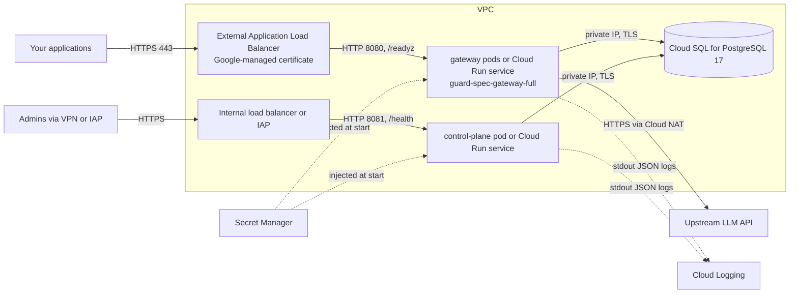

<!-- Copyright 2026 The Guard Spec Authors -->
<!-- SPDX-License-Identifier: Apache-2.0 -->

# Deploying on Google Cloud

> **Status: reference template, not yet verified by the maintainers.**
> Community-tested: not yet. If you deploy this, please open an
> [issue](https://github.com/guard-spec/guard-spec/issues/new/choose) or a pull
> request with what worked and what did not. See
> [CONTRIBUTING.md](../../CONTRIBUTING.md) and the [index](README.md).

Two ways to run the services, same database and secrets:

- **A. GKE Autopilot**: the Helm chart in `deploy/helm/guard-spec`, following
  the [Kubernetes steps](on-premise.md#2-kubernetes) with Google Cloud pieces
  swapped in.
- **B. Cloud Run**: no cluster. Uses the `gateway-full` image, so no shared
  model volume.

The commands and YAML below are templates: placeholders such as
`<project-id>`, `<region>` and `<your-db-host>` must be filled in, and nothing
here was run against a real Google Cloud project.

## Architecture



| Need | Google Cloud service |
|---|---|
| Compute | GKE Autopilot, or Cloud Run |
| Database | Cloud SQL for PostgreSQL 17, private IP only, SSL required |
| Secrets | Secret Manager |
| TLS and routing | External Application Load Balancer with a Google-managed certificate (GKE Ingress, or a serverless NEG for Cloud Run) |
| Logs | Cloud Logging (collected from stdout on both platforms) |
| Metrics and traces | Prometheus endpoints on 9090/9091 (Managed Service for Prometheus on GKE); traces over OTLP/HTTP to an OpenTelemetry collector |
| Images | `ghcr.io` directly (GKE), or a copy in Artifact Registry (needed for Cloud Run) |

## Prerequisites

- A project with billing, the `gcloud` CLI, `docker`, `openssl`, `jq`.
- A VPC with Private Services Access configured (for Cloud SQL private IP)
  and Cloud NAT for the upstream LLM and image pulls.
- A domain for the gateway (`<gateway-host>`) and one for the admin UI
  (`<admin-host>`).
- A VM inside the VPC with Docker for one-off tasks (migrations, app
  password), reached with IAP TCP forwarding, or a CI runner in the VPC.
- A checkout of the release tag on that VM:
  `git clone --branch v0.1.0 https://github.com/guard-spec/guard-spec.git`.

## Sizing

The README has no server benchmarks. Measure under your traffic. Starting
points:

| Service | Size | Basis |
|---|---|---|
| gateway (L1 + L2 + L3) | 1 vCPU, 2 GiB, 2 replicas or minimum instances | About 900 MiB of memory right after start in a local check of `gateway-full:0.1.0`; the chart's 1Gi limit is too tight for the model layers |
| gateway (L1 only) | 0.5 vCPU, 1 GiB | Measure |
| control plane | 0.25 to 1 vCPU, 512 MiB, 1 replica | Chart defaults: 100m CPU, 64Mi request, 256Mi limit; Cloud Run has its own minimums |
| Cloud SQL | Enterprise edition, `db-custom-1-3840`, 20 GB SSD | Measure: the audit table grows with every request, bounded by `AUDIT_RETENTION_DAYS` |

## Step 1: database

```bash
# Template.
gcloud sql instances create guard-spec \
  --database-version=POSTGRES_17 --edition=ENTERPRISE \
  --tier=db-custom-1-3840 --region=<region> \
  --network=projects/<project-id>/global/networks/<vpc> --no-assign-ip \
  --ssl-mode=ENCRYPTED_ONLY \
  --backup-start-time=03:00 --enable-point-in-time-recovery \
  --deletion-protection

gcloud sql databases create guardspec --instance=guard-spec
gcloud sql users create gsowner --instance=guard-spec --password='<owner-password>'
```

- `--edition=ENTERPRISE` is set because newer PostgreSQL versions default to
  Enterprise Plus, which needs other tiers.
- `gsowner` (a built-in user, member of `cloudsqlsuperuser`) runs the
  migrations. They create the `pgcrypto` and `pg_trgm` extensions and the
  `guardspec_app` role. The services never use `gsowner`.
- `--ssl-mode=ENCRYPTED_ONLY` refuses unencrypted connections; use
  `sslmode=require` in every URL below. The private IP is `<your-db-host>`
  (`gcloud sql instances describe guard-spec --format='value(ipAddresses[0].ipAddress)'`).
- Store the owner password in Secret Manager too (`guard-spec-owner-password`).

### Migrations and the application password

From the VM inside the VPC, in the checkout of the release tag:

```bash
DB_HOST=<your-db-host>
export PGPASSWORD="$(gcloud secrets versions access latest --secret=guard-spec-owner-password)"

docker run --rm -e PGPASSWORD -v "$PWD/migrations:/migrations:ro" migrate/migrate:v4.20.1 \
  -path=/migrations -database "postgres://gsowner@$DB_HOST:5432/guardspec?sslmode=require" up
```

After creating the secrets (step 2), apply the application password:

```bash
export GUARDSPEC_APP_PASSWORD="$(gcloud secrets versions access latest --secret=guard-spec-app-password)"

docker run --rm -e PGPASSWORD -e GUARDSPEC_APP_PASSWORD \
  -e PGHOST="$DB_HOST" -e PGUSER=gsowner -e PGDATABASE=guardspec -e PGSSLMODE=require \
  -v "$PWD/deploy/postgres/set-app-password.sh:/set-app-password.sh:ro" \
  --entrypoint /bin/sh postgres:17.11-alpine /set-app-password.sh
# guardspec_app password set
```

Run both again after every upgrade and every rotation of the app password.

## Step 2: secrets

```bash
openssl rand -hex 32    | tr -d '\n' | gcloud secrets create guard-spec-app-password   --data-file=-
openssl rand -hex 32    | tr -d '\n' | gcloud secrets create guard-spec-jwt-secret     --data-file=-
openssl rand -base64 32 | tr -d '\n' | gcloud secrets create guard-spec-mfa-enc-key    --data-file=-
openssl rand -hex 16    | tr -d '\n' | gcloud secrets create guard-spec-admin-password --data-file=-
printf '%s' '<your-upstream-key>'    | gcloud secrets create guard-spec-upstream-llm-key --data-file=-
```

**`MFA_ENC_KEY` is not recoverable.** It encrypts every user's TOTP secret.
Keep a copy outside this project (an offline vault), and keep it with your
Cloud SQL backups: a backup restored without the matching key locks out every
user with 2FA. Never destroy old versions of `guard-spec-mfa-enc-key`; the
control plane has no re-encryption step.

Give each runtime service account `roles/secretmanager.secretAccessor` on the
secrets it needs only (not on the project).

## Option A: GKE Autopilot

Create a private Autopilot cluster in the same VPC, then follow
[Kubernetes](on-premise.md#2-kubernetes) in the on-premise guide. The Google
Cloud specific parts:

- **Images.** Autopilot nodes pull `ghcr.io` images through Cloud NAT.
  Optionally copy them to Artifact Registry (see Option B) and set
  `gateway.image.repository` and `controlPlane.image.repository`.
- **Security context.** The chart's settings (non-root UID 65532, read-only
  root filesystem, all capabilities dropped, RuntimeDefault seccomp) are
  accepted by Autopilot as they are.
- **Secrets.** Sync the Secret Manager values into the Kubernetes Secrets the
  chart expects (`guard-spec-secrets` with `POSTGRES_PASSWORD`,
  `GUARDSPEC_APP_PASSWORD`, `JWT_SECRET`, `ADMIN_PASSWORD`; a second Secret
  with `MFA_ENC_KEY` for `controlPlane.extraEnvFrom`) with the External
  Secrets Operator or the Secret Manager add-on, or create them with
  `kubectl create secret` from a trusted machine.
- **Models.** The default storage class (`standard-rwo`) is ReadWriteOnce, so
  two gateway replicas on different nodes cannot share the chart's PVC. Use
  a ReadWriteMany claim backed by Filestore (`models.existingClaim`), filled
  by the [models Job](on-premise.md#step-3-models); or keep
  `gateway.replicaCount=1`; or use `gateway-full` with the
  [kustomize workaround](on-premise.md#gateway-full-with-the-helm-chart).
- **Migrations.** The [migration Job](on-premise.md#step-2-migrations-no-chart-job-yet)
  works as is, with the Cloud SQL private IP as host and `gsowner` as owner.
  `dbRoles.enabled=true` sets the app password.
- **Resources.** Autopilot bills by requests. Set `gateway.resources.requests`
  to what the gateway really needs (see [Sizing](#sizing)); a request lower
  than the limit can be raised by Autopilot.
- **Ingress.** Template for GKE Ingress with a Google-managed certificate. The
  chart's Service has no annotations value, so annotate it after install to
  attach the BackendConfig (longer timeout for streamed answers):

  ```yaml
  apiVersion: networking.gke.io/v1
  kind: ManagedCertificate
  metadata:
    name: guard-spec-gateway
  spec:
    domains: [<gateway-host>]
  ---
  apiVersion: cloud.google.com/v1
  kind: BackendConfig
  metadata:
    name: guard-spec-gateway
  spec:
    timeoutSec: 300
    healthCheck:
      type: HTTP
      requestPath: /readyz
      port: 8080
  ---
  apiVersion: networking.k8s.io/v1
  kind: Ingress
  metadata:
    name: guard-spec-gateway
    annotations:
      kubernetes.io/ingress.class: gce
      kubernetes.io/ingress.global-static-ip-name: <static-ip-name>
      networking.gke.io/managed-certificates: guard-spec-gateway
  spec:
    defaultBackend:
      service: {name: gs-guard-spec-gateway, port: {number: 8080}}
  ```

  ```bash
  kubectl annotate service gs-guard-spec-gateway \
    cloud.google.com/backend-config='{"default": "guard-spec-gateway"}'
  ```

  For the control plane, use an internal Ingress
  (`kubernetes.io/ingress.class: gce-internal`, which needs a proxy-only
  subnet) or `kubectl port-forward`, never the external one.
- **Metrics.** Managed Service for Prometheus can scrape the `*-metrics`
  Services with a `PodMonitoring` resource on port `metrics`.

## Option B: Cloud Run

### Images

Cloud Run deploys from Artifact Registry (and Docker Hub), not from
`ghcr.io`. Copy the images, after verifying their signatures
([SECURITY.md](../../SECURITY.md#verifying-releases)), or create an Artifact
Registry remote repository that proxies `ghcr.io`:

```bash
gcloud artifacts repositories create guard-spec --repository-format=docker --location=<region>
gcloud auth configure-docker <region>-docker.pkg.dev
crane copy ghcr.io/guard-spec/guard-spec-gateway-full:0.1.0 \
  <region>-docker.pkg.dev/<project-id>/guard-spec/guard-spec-gateway-full:0.1.0
crane copy ghcr.io/guard-spec/guard-spec-control-plane:0.1.0 \
  <region>-docker.pkg.dev/<project-id>/guard-spec/guard-spec-control-plane:0.1.0
```

### Models

Use `guard-spec-gateway-full`: the models are in the image, every instance
starts with L1 + L2 + L3, and `DETECTOR_REQUIRE_ML=true` stops an instance
that cannot load them instead of running on L1 alone.

### Things specific to Cloud Run

- **Authentication.** The gateway checks its own API keys in the
  `Authorization: Bearer gs_...` header, which conflicts with Cloud Run's IAM
  check on the same header. Allow unauthenticated invocations on the gateway
  and restrict ingress to the load balancer instead.
- **CPU always allocated.** Both services do work outside requests (audit
  writes, the control plane's retention job, alert delivery, session checks).
  Set `run.googleapis.com/cpu-throttling: "false"` and keep at least one
  instance.
- **One port.** Cloud Run routes to one container port. The metrics
  listeners (9090, 9091) are not reachable from outside the instance; scrape
  them with a collector sidecar, or set `METRICS_ADDR=off`.
- **Request timeout.** `timeoutSeconds` bounds each request, including
  streamed answers. 300 matches the default `UPSTREAM_LLM_TIMEOUT`; raise both
  for very long answers (the Cloud Run maximum is 3600).

### Gateway service

```yaml
# gateway.yaml (template): gcloud run services replace gateway.yaml --region=<region>
apiVersion: serving.knative.dev/v1
kind: Service
metadata:
  name: guard-spec-gateway
  annotations:
    run.googleapis.com/ingress: internal-and-cloud-load-balancing
spec:
  template:
    metadata:
      annotations:
        autoscaling.knative.dev/minScale: "1"
        autoscaling.knative.dev/maxScale: "10"
        run.googleapis.com/cpu-throttling: "false"
        run.googleapis.com/execution-environment: gen2
        run.googleapis.com/network-interfaces: '[{"network":"<vpc>","subnetwork":"<subnet>"}]'
        run.googleapis.com/vpc-access-egress: private-ranges-only
    spec:
      serviceAccountName: guard-spec-gateway@<project-id>.iam.gserviceaccount.com
      timeoutSeconds: 300
      containers:
        - image: <region>-docker.pkg.dev/<project-id>/guard-spec/guard-spec-gateway-full:0.1.0
          ports:
            - containerPort: 8080
          resources:
            limits: {cpu: "1", memory: 2Gi}
          env:
            - name: DATABASE_URL
              value: postgres://guardspec_app@<your-db-host>:5432/guardspec?sslmode=require
            - name: UPSTREAM_LLM_URL
              value: <your-upstream-url>
            - name: UPSTREAM_ALLOW_PRIVATE
              value: "false"
            - name: PGPASSWORD
              valueFrom:
                secretKeyRef: {name: guard-spec-app-password, key: "1"}
            - name: UPSTREAM_LLM_KEY
              valueFrom:
                secretKeyRef: {name: guard-spec-upstream-llm-key, key: "1"}
          startupProbe:
            httpGet: {path: /readyz, port: 8080}
            periodSeconds: 5
            failureThreshold: 24
          livenessProbe:
            httpGet: {path: /health, port: 8080}
            periodSeconds: 10
```

```bash
gcloud run services replace gateway.yaml --region=<region>
gcloud run services add-iam-policy-binding guard-spec-gateway --region=<region> \
  --member=allUsers --role=roles/run.invoker
```

`key: "1"` pins the secret version; bump it on rotation instead of using
`latest`, so that a rotation is a deliberate redeploy.

### Control plane service

Same shape, with `ingress: internal` so that only the VPC (and your VPN)
reaches it:

```yaml
# control-plane.yaml (template)
apiVersion: serving.knative.dev/v1
kind: Service
metadata:
  name: guard-spec-control-plane
  annotations:
    run.googleapis.com/ingress: internal
spec:
  template:
    metadata:
      annotations:
        autoscaling.knative.dev/minScale: "1"
        run.googleapis.com/cpu-throttling: "false"
        run.googleapis.com/network-interfaces: '[{"network":"<vpc>","subnetwork":"<subnet>"}]'
        run.googleapis.com/vpc-access-egress: private-ranges-only
    spec:
      serviceAccountName: guard-spec-control-plane@<project-id>.iam.gserviceaccount.com
      containers:
        - image: <region>-docker.pkg.dev/<project-id>/guard-spec/guard-spec-control-plane:0.1.0
          ports:
            - containerPort: 8081
          resources:
            limits: {cpu: "1", memory: 512Mi}
          env:
            - {name: DATABASE_URL, value: "postgres://guardspec_app@<your-db-host>:5432/guardspec?sslmode=require"}
            - {name: ADMIN_EMAIL, value: <admin-email>}
            - {name: PUBLIC_BASE_URL, value: "https://<admin-host>"}
            - {name: AUDIT_RETENTION_DAYS, value: "90"}
            - name: PGPASSWORD
              valueFrom: {secretKeyRef: {name: guard-spec-app-password, key: "1"}}
            - name: JWT_SECRET
              valueFrom: {secretKeyRef: {name: guard-spec-jwt-secret, key: "1"}}
            - name: MFA_ENC_KEY
              valueFrom: {secretKeyRef: {name: guard-spec-mfa-enc-key, key: "1"}}
            - name: ADMIN_PASSWORD
              valueFrom: {secretKeyRef: {name: guard-spec-admin-password, key: "1"}}
          startupProbe:
            httpGet: {path: /health, port: 8081}
          livenessProbe:
            httpGet: {path: /health, port: 8081}
            periodSeconds: 10
```

Admin access goes through an internal Application Load Balancer with a
serverless NEG, reached over your VPN, or an external one protected by
Identity-Aware Proxy. Set `TRUSTED_PROXIES` to the load balancer's
proxy-only subnet if you put one in front; leave it empty otherwise.

### Load balancer for the gateway

A global external Application Load Balancer with a serverless NEG pointing at
`guard-spec-gateway` and a Google-managed certificate for `<gateway-host>`.
With a serverless NEG the backend service timeout does not apply; the Cloud
Run `timeoutSeconds` does.

```bash
gcloud compute network-endpoint-groups create guard-spec-gateway-neg \
  --region=<region> --network-endpoint-type=serverless --cloud-run-service=guard-spec-gateway
gcloud compute backend-services create guard-spec-gateway \
  --global --load-balancing-scheme=EXTERNAL_MANAGED
gcloud compute backend-services add-backend guard-spec-gateway --global \
  --network-endpoint-group=guard-spec-gateway-neg --network-endpoint-group-region=<region>
gcloud compute url-maps create guard-spec-gateway --default-service=guard-spec-gateway
gcloud compute ssl-certificates create guard-spec-gateway --domains=<gateway-host> --global
gcloud compute target-https-proxies create guard-spec-gateway \
  --url-map=guard-spec-gateway --ssl-certificates=guard-spec-gateway
gcloud compute forwarding-rules create guard-spec-gateway --global \
  --load-balancing-scheme=EXTERNAL_MANAGED --target-https-proxy=guard-spec-gateway --ports=443
```

### Check

```bash
curl -s https://<gateway-host>/readyz | jq .detector
# {"layers":["l1","l2","l3"],"degraded":false,"onnx":true,...}
```

Then log in to `https://<admin-host>/ui/` as `<admin-email>` with the
`guard-spec-admin-password` secret, turn on 2FA, and create the first API key
as in the README's [Quick start](../../README.md#quick-start).

## Observability

- **Logs.** Both services log JSON lines to stdout; Cloud Logging collects
  them on GKE and Cloud Run. Filter with `jsonPayload.level="ERROR"`.
- **Metrics.** Prometheus format at `/metrics` on 9090 (gateway) and 9091
  (control plane); names in the README's [Metrics](../../README.md#metrics).
- **Traces.** OTLP over HTTP only (no gRPC). Run an OpenTelemetry collector
  (a sidecar on Cloud Run, a Deployment on GKE) that exports to Cloud Trace,
  and set `OTEL_EXPORTER_OTLP_ENDPOINT` on the gateway to its `:4318`
  address.
- **Alerts worth having.** Load balancer 5xx rate; the gateway's
  `requests_total{decision="error"}` and `upstream_errors_total`;
  `policy_eval_errors_total` (requests fail closed with 503); Cloud SQL disk
  use.

## Hardening checklist

No extra cost:

- [ ] Cloud SQL: private IP only, `ENCRYPTED_ONLY`, deletion protection,
      backups and point-in-time recovery on.
- [ ] Control plane not on the external load balancer; Cloud Run ingress
      `internal`, or an internal GKE Ingress.
- [ ] Gateway Cloud Run ingress `internal-and-cloud-load-balancing`, so the
      `run.app` URL cannot bypass the load balancer.
- [ ] One service account per service, `secretAccessor` on its own secrets
      only.
- [ ] `MFA_ENC_KEY` copied to an offline vault; old secret versions kept.
- [ ] Secret versions pinned (`key: "1"`), images pinned to a version or
      digest, signatures verified before copying.
- [ ] `UPSTREAM_ALLOW_PRIVATE=false` and `UPSTREAM_KEY_ORGS` without `*` if
      untrusted users can create organizations.
- [ ] Metrics ports not exposed outside the cluster or instance.

Costs money but worth considering: Cloud Armor in front of the gateway (its
rate limits are per instance and in memory), a regional (HA) Cloud SQL
instance.

## Upgrade and rollback

1. Read the [CHANGELOG](../../CHANGELOG.md). Before 1.0, minor versions can
   change the schema.
2. Take an on-demand Cloud SQL backup.
3. On the VM, check out the new tag and run the
   [migrations and the app password](#migrations-and-the-application-password)
   again.
4. Cloud Run: change the image tag and `gcloud run services replace` each
   service; a new revision gets traffic once its startup probe passes. GKE:
   follow the [Kubernetes upgrade steps](on-premise.md#upgrade-and-rollback-1).
5. Check `/readyz` and the logs.

Rolling back the images: route traffic to the previous Cloud Run revision
(`gcloud run services update-traffic guard-spec-gateway --to-revisions=<revision>=100`)
or `helm rollback`. That does not undo migrations: if the new version changed
the schema, restore the backup (with the `MFA_ENC_KEY` that matches it).

## Troubleshooting

| Symptom | Likely cause |
|---|---|
| Revision fails to start, log names a variable | A secret is missing, a default or too short |
| `Permission denied on secret` | The service account lacks `secretAccessor` on that secret |
| `db connect` and exit | No VPC egress to the private IP, `sslmode` missing (`ENCRYPTED_ONLY`), or `guardspec_app` has no password yet |
| Migration fails on `CREATE ROLE guardspec_app` | The role exists on this instance from another database; use a separate instance |
| Cloud Run returns 403 before reaching the gateway | IAM invoker check is on; allow unauthenticated invocations (the gateway checks API keys itself). If an organization policy forbids `allUsers`, turn off the invoker check on the service instead |
| Image cannot be deployed to Cloud Run | The image is still on `ghcr.io`; copy it to Artifact Registry |
| Gateway instance stops with a model error | Not enough memory, or `gateway-full` with a volume over `/models` |
| `/readyz` shows `"layers":["l1"]` | Plain gateway image without models |
| Streams stop after 30 seconds on GKE | The BackendConfig is not attached; check the Service annotation |
| Logins all come from one address in the activity log | `TRUSTED_PROXIES` not set to the load balancer's range |
