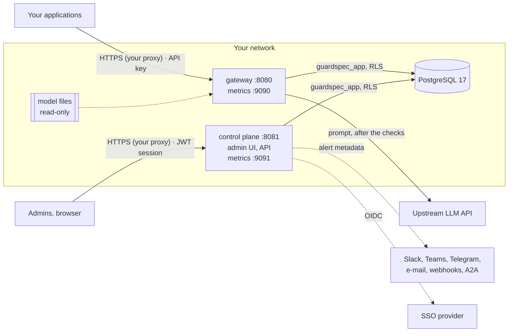

<!-- Copyright 2026 The Guard Spec Authors -->
<!-- SPDX-License-Identifier: Apache-2.0 -->

# Guard Spec for security teams

> Tiếng Việt: [README.vi.md](README.vi.md).

What a security review of a Guard Spec deployment needs in one place: the
components and their trust boundaries, which data goes where, what is
stored, for how long and how it is protected, and how to check that the
release you run is the one this project built. Everything here is derived
from the code and migrations of the release it ships with (0.1.x); where a
statement depends on a setting, the setting is named.

| Document | Covers |
|---|---|
| This page | Architecture, data flow, stored data and retention, secrets, encryption |
| [Verifying a release](verifying-releases.md) | cosign signatures of the images and archives, SBOMs, SLSA provenance, with the commands and their output for v0.2.0 |
| [Security risks and hardening](../security-risks.md) | The threat model: risks that remain in a deployment, what reduces each, and a hardening checklist |
| [SECURITY.md](../../SECURITY.md) | Reporting a vulnerability, supported versions, response targets |
| [Security model and limitations](../../README.md#security-model-and-limitations) | What detection does and does not protect against |

## Contents

- [Architecture](#architecture)
- [Data flow of one request](#data-flow-of-one-request)
- [What is stored, where and for how long](#what-is-stored-where-and-for-how-long)
- [Secrets](#secrets)
- [Encryption](#encryption)
- [Tenant isolation](#tenant-isolation)
- [Shared scan cache](#shared-scan-cache)
- [What leaves your network](#what-leaves-your-network)
- [Threat model](#threat-model)
- [Verifying a release](#verifying-a-release)

## Architecture

Two Go services and one PostgreSQL database. Nothing else is required; a
Redis (or Valkey) is optional, as the [shared scan cache](#shared-scan-cache)
of several gateway replicas.

| Component | Trust boundary | Listens on | Talks to |
|---|---|---|---|
| **Gateway** (`cmd/gateway`) | Facing your applications. Authenticates them with API keys (`Authorization: Bearer gs_...`) | 8080 API, 9090 metrics | PostgreSQL; the upstream LLM; an OTLP collector if configured |
| **Control plane** (`cmd/control-plane`) | Facing admins only; keep it off the internet ([P2](../security-risks.md#p2-control-plane-or-metrics-reachable-from-the-internet)). Authenticates users with passwords, TOTP and OIDC; issues HS256 JWTs bound to a session row | 8081 API and admin UI (`/ui/`), 9091 metrics | PostgreSQL; SSO providers; alert channels; the upstream only for an owner's "test upstream" call |
| **PostgreSQL** | Holds all state. The services connect as `guardspec_app` (no superuser, no `BYPASSRLS`); the owner role runs the migrations only | 5432 | — |
| **Model files** | L2 classifier and L3 embedder, ONNX, loaded in process. Pinned by SHA-256 in `models/manifest.yaml`, or inside the `gateway-full` image | — | — |

Neither service terminates TLS: put a reverse proxy or load balancer in
front ([P1](../security-risks.md#p1-services-exposed-without-tls)), and set
`TRUSTED_PROXIES` on the control plane so that rate limits, sessions and the
activity log see the client address ([I5](../security-risks.md#i5-wrong-trusted_proxies)).
The release images run as non-root with a read-only root filesystem.

## Data flow of one request

1. An application sends an OpenAI-compatible or Anthropic Messages request
   to the gateway with its API key. The gateway hashes the key (SHA-256) and looks it up; the
   plaintext key is never stored.
2. The sanitizer (L0) strips invisible and bidi characters. The detection
   layers score the parts listed in `SCAN_ROLES` (L1 rules, L2 classifier,
   L3 similarity, all in process). The org's policies (CEL) decide: allow,
   block, log or route.
3. **Blocked:** the gateway answers 400 and the upstream is never called.
   **Allowed:** the request goes to the upstream LLM chosen by routing, with
   the upstream's key from an environment variable.
4. The output guard checks the answer (links and images to unknown hosts,
   personal data, a leaked canary), also while streaming, and the answer goes
   back to the application.
5. The gateway writes one audit row (`requests`) and, for blocks, an event
   (`events`) that the control plane's alert worker turns into
   notifications.

Prompt and answer text exist in the gateway's memory during the request. By
default they are **not written anywhere** by Guard Spec: not to the audit
row (only a SHA-256 and the length), not to logs (log lines carry scores,
rule ids and decisions), not to traces (span attributes are the HTTP method,
route, status and upstream path), not to events or notifications (metadata
only: ids, categories, scores).

## What is stored, where and for how long

Everything is in PostgreSQL. The services keep no state on disk; the
gateway's rate-limit counters and caches are in memory, except the scan cache
when `SCAN_CACHE_BACKEND` shares it (below and
[Shared scan cache](#shared-scan-cache)).

| Data | Table(s) | Contents | Kept for |
|---|---|---|---|
| **Request log (audit)** | `requests` | Org, project, SHA-256 of the API key, model, decision, rule id, layer scores, PII entity types found, sanitizer flags, token counts, latency, route target, SHA-256 and length of the request body and of a buffered response. **Prompt and response text only** when content storage is on: `AUDIT_STORE_CONTENT=true` on the gateway (every org) or `audit_store_content` on one organization (admin role, recorded in the activity log) | `AUDIT_RETENTION_DAYS` (default **90**; `0` keeps them forever). The control plane deletes older rows in batches at start and every `AUDIT_RETENTION_INTERVAL` (default 1h); one replica at a time (advisory lock) |
| **Activity log** | `activity_log` | Who changed what: members, invites, API keys, policies, upstreams, security and config changes, 2FA resets, SSO providers, logins (success and failure). Actor, action, target, client IP, details without secrets; a failed login keeps the e-mail masked (`a***@example.com`) | `ACTIVITY_LOG_RETENTION_DAYS` (default **365**; `0` keeps them forever). Deleted by the audit retention job (same interval, batches and advisory lock), across every org and the instance-level rows. Export or archive before if your policy needs a longer record |
| **Users and memberships** | `users`, `org_memberships`, `project_memberships`, `user_identities` | E-mail (lower-cased), display name, bcrypt password hash (none for SSO-only accounts), roles, linked SSO subject per provider | Until the user is deleted |
| **Sessions** | `sessions` | One row per login: method, user agent, client IP, created, last seen, revoked. Tokens last 12 hours (or the org's `session_lifetime_hours`) | Active sessions are kept. A session revoked or expired more than `SESSION_RETENTION_DAYS` ago (default **30**; `0` keeps them forever) is deleted by the same retention job |
| **Two-factor authentication** | `user_mfa`, `mfa_recovery_codes`, `mfa_challenges` | TOTP secret **encrypted** (AES-256-GCM with `MFA_ENC_KEY`, bound to the user id); 10 recovery codes as bcrypt hashes; login challenges | Secrets until 2FA is reset; challenges deleted an hour after they expire (5 minutes) |
| **SSO flow state** | `oidc_states`, `oidc_codes` | State, nonce and PKCE verifier (state stored as a hash, bound to the browser); one-time exchange codes as hashes | States 10 minutes, deleted when expired; codes 60 seconds, deleted an hour later |
| **Invites and link codes** | `invites`, `email_link_codes`, `telegram_link_codes`, `channel_link_codes`, `channel_email_addresses` | Only the SHA-256 of each token or code, plus the e-mail or chat it is for | Until used or expired, or the parent is deleted |
| **API keys** | `api_keys` | SHA-256 of the key, a short prefix for display (`gs_` and 8 characters), alias, limits | Until deleted |
| **Configuration** | `organizations`, `projects`, `policies`, `upstreams`, `org_security`, `identity_providers`, `notification_channels`, `alert_rules`, `user_groups` | Policies (CEL), upstream URLs and the **name** of their key variable, SSO client ids and the **name** of their secret variable, channel settings and the **name** of their secret variable | Until changed or deleted |
| **Org exemplars (L3)** | `org_exemplars` | Example attack texts an admin adds for that org's similarity layer | Until deleted |
| **Scan cache** (`SCAN_CACHE_BACKEND=postgres`) | `scan_cache` | Per text the gateway classified (system prompt, tool definition, tool result, document): a SHA-256 key, the org, detector scores and verdict metadata (fused and layer scores, categories, rule ids, PII types and offsets) and the model identity. **No text**, no tool name | 6 hours: an expired row is never read, and the retention job deletes expired rows whatever the retention periods are. With `SCAN_CACHE_BACKEND=redis` the same values are in Redis with `EXPIRE` 6 h |
| **Alerts** | `events`, `alert_rule_hits`, `alerts`, `notification_outbox`, `notifications` | Event type, severity, ids, categories, scores; delivery state | Processed events 30 days, finished deliveries 30 days, read in-app notifications 90 days, rule hits 24 hours; `alerts` are kept |

Outside the database:

- **Logs** (stdout, JSON lines): no prompt or response text, no secrets.
  Their retention is whatever your log pipeline sets.
- **Metrics**: fixed label sets; per-org series only with
  `METRICS_TENANT_LABELS=true`.
- **Backups** of the database hold everything above, including audit
  content if it was stored. They inherit its sensitivity.

## Secrets

| Secret | Used by | Stored | Notes |
|---|---|---|---|
| `GUARDSPEC_APP_PASSWORD` (as `PGPASSWORD`) | both services | Your secret store; the database keeps its SCRAM hash | Set with `deploy/postgres/set-app-password.sh` after each migration run |
| `JWT_SECRET` | control plane | Your secret store | At least 32 bytes; signs session tokens (HS256). Rotating it logs everyone out |
| `MFA_ENC_KEY` | control plane | Your secret store | 32 bytes, base64. **Not recoverable**: without it nobody with 2FA can log in ([I2](../security-risks.md#i2-lost-mfa_enc_key)). Back it up with the database; there is no re-encryption, so do not rotate it automatically |
| `ADMIN_PASSWORD` | control plane, first start only | Your secret store; bcrypt hash in `users` | Creates the first owner once |
| `UPSTREAM_LLM_KEY`, `UPSTREAM_KEY_*` | gateway (and the control plane for upstream tests, if given) | Environment only | The database holds only the variable **name**; `UPSTREAM_KEY_ORGS` decides which org may use which key |
| `OIDC_SECRET_*` | control plane | Environment only | Named by each SSO provider's `client_secret_env` |
| Alert channel secrets (`SLACK_*`, `TEAMS_*`, `TELEGRAM_BOT_TOKEN_*`, `WEBHOOK_SECRET_*`, `A2A_*`, `GUARDSPEC_ALERT_*`) | control plane | Environment only | Named by each channel's `secret_env` |

Outside `GUARD_ENV=dev` the services refuse to start with a missing, short
or known default secret. API keys, invite tokens, link codes and recovery
codes are shown once and stored only as hashes.

## Encryption

- **In transit.** Terminate TLS in front of both services. Use
  `sslmode=require` (or `verify-full`) in `DATABASE_URL` for a database on
  another host. Upstream, SSO and alert calls use HTTPS as configured.
- **At rest, by Guard Spec.** TOTP secrets: AES-256-GCM with `MFA_ENC_KEY`.
  Passwords and recovery codes: bcrypt. API keys and one-time tokens: SHA-256.
  Nothing else is encrypted by the application.
- **At rest, by your platform.** Audit rows (and their content, if stored),
  the activity log, e-mail addresses and IP addresses rely on the
  database's storage encryption: turn it on (RDS `storage_encrypted`, Cloud
  SQL default encryption, LUKS or similar on-premise) and for backups too.

## Tenant isolation

Every org-scoped table has PostgreSQL row-level security on
`app.org_id`, which the services set per transaction; the application role
cannot bypass it. Tables keyed by user (sessions, identities, 2FA) are not
org-scoped and are read by user id. A failure to evaluate policies or org
settings fails the request closed (503).

## Shared scan cache

With more than one gateway replica, `SCAN_CACHE_BACKEND=redis` or `postgres`
shares the scan cache (README, [Scan cache](../../README.md#scan-cache)), so a
long `/v1/messages` or `/v1/responses` session does not have to classify its whole history again
on another replica or after a restart.

**What it stores.** For each text: the detector's scores and verdict metadata,
and the identity of the models that computed them. The key is a SHA-256 of the
org, the kind of text, its full content and the model identity. No text, no
tool name, nothing an attacker who reads the cache could turn back into the
content, except by guessing a text and hashing it (the key is unsalted, so a
reader can confirm that a known text was sent by that org within 6 hours).

**Threats.**

- *Cache poisoning.* An attacker who can **write** to the backend can store a
  low score under the key of a malicious text and so have it pass as clean,
  for the org the key was made for. Keep Redis on a private network (no
  published port; in Kubernetes, a NetworkPolicy that admits the gateway pods
  only), require authentication (`requirepass` or an ACL user limited to
  `guardspec:scan:*`), and use `rediss://` across hosts. Do not share that
  Redis with other applications. The compose `scan-cache` service has no
  published port and refuses to start without a password of 16 characters
  or more. With Postgres, the table is written by the gateway's role only and
  row level security binds every row to its org: a replica or a stolen
  connection scoped to one org cannot plant entries for another.
- *Stale scores.* An entry keys on the exact model identity (gateway binary,
  model files, calibration, detector configuration), so a model change can
  never reuse an old score; per-org exemplars added later apply once an entry
  expires (6 h), as with the in-process cache.
- *Availability.* A slow or failing backend is skipped after
  `SCAN_CACHE_TIMEOUT` (50 ms): the text is scanned. The cache never decides
  that something is not scanned, and its failure never fails a request.
- *Memory.* Bound Redis with `maxmemory` and a `volatile-*` eviction policy
  (the compose service uses 256 MB, `volatile-lru`); an evicted entry only
  costs a rescan.

## What leaves your network

| To | What | When |
|---|---|---|
| Upstream LLM | The request as the application sent it, after sanitizing (and spotlighting, if on) | Every allowed request |
| SSO provider | OIDC authorization flow | SSO logins |
| Alert channels | Alert metadata: event type, severity, ids, categories, scores. No prompt text | Matching alert rules |
| OTLP collector | Spans without prompt text; `traceparent` to the upstream only with `OTEL_PROPAGATE_UPSTREAM=true` | Tracing on |
| Hugging Face (or `MODELS_MIRROR`) | Model downloads, checked against SHA-256 pins | `models pull` only; `gateway-full` needs none |

There is no telemetry or call home.

## Threat model

The risks that remain when you run Guard Spec, grouped as detection,
application, deployment, identity, data, supply chain and operations risks,
each with what reduces it, are in
[Security risks and hardening](../security-risks.md) (Vietnamese:
[security-risks.vi.md](../security-risks.vi.md)). Its
[hardening checklist](../security-risks.md#hardening-checklist) is the
shortest path to a reviewed deployment.

## Verifying a release

Images are signed with cosign (keyless, GitHub Actions OIDC) and carry SPDX
SBOMs and SLSA provenance; archives are covered by signed checksum files.
The commands, what each check proves and their output for v0.2.0 are in
[Verifying a release](verifying-releases.md).
