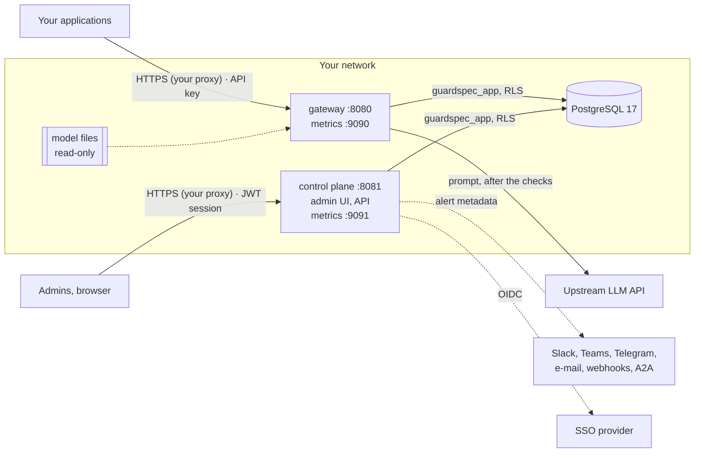

<!-- Copyright 2026 The Guard Spec Authors -->
<!-- SPDX-License-Identifier: Apache-2.0 -->

# Guard Spec dành cho đội bảo mật

> English: [README.md](README.md). Nếu hai bản khác nhau, bản tiếng Anh là bản chính.

Trang này gom vào một chỗ những gì cần cho việc đánh giá bảo mật một bản triển
khai Guard Spec: các thành phần và ranh giới tin cậy của chúng, dữ liệu nào đi
đâu, những gì được lưu, lưu bao lâu và được bảo vệ ra sao, và cách kiểm tra
rằng bản phát hành bạn đang chạy đúng là bản do dự án này build. Mọi thông tin
ở đây đều rút ra từ code và migration của bản phát hành đi kèm (0.1.x); khi một
nhận định phụ thuộc vào một thiết lập, thiết lập đó được nêu tên.

| Tài liệu | Nội dung |
|---|---|
| Trang này | Kiến trúc, luồng dữ liệu, dữ liệu được lưu và thời hạn lưu, secret, mã hoá |
| [Xác minh một bản phát hành](verifying-releases.md) | Chữ ký cosign của image và archive, SBOM, SLSA provenance, kèm lệnh và kết quả của chúng cho v0.2.0 |
| [Rủi ro bảo mật và gia cố](../security-risks.vi.md) | Mô hình mối đe doạ: các rủi ro còn lại trong một bản triển khai, cách giảm từng rủi ro, và checklist gia cố |
| [SECURITY.md](../../SECURITY.md) | Báo lỗ hổng, các phiên bản được hỗ trợ, mục tiêu thời gian phản hồi |
| [Mô hình bảo mật và giới hạn](../../README.vi.md#mô-hình-bảo-mật-và-giới-hạn) | Phát hiện bảo vệ được gì và không bảo vệ được gì |

## Mục lục

- [Kiến trúc](#kiến-trúc)
- [Luồng dữ liệu của một request](#luồng-dữ-liệu-của-một-request)
- [Dữ liệu nào được lưu, ở đâu và trong bao lâu](#dữ-liệu-nào-được-lưu-ở-đâu-và-trong-bao-lâu)
- [Secret](#secret)
- [Mã hoá](#mã-hoá)
- [Cách ly tenant](#cách-ly-tenant)
- [Scan cache dùng chung](#scan-cache-dùng-chung)
- [Những gì đi ra khỏi mạng của bạn](#những-gì-đi-ra-khỏi-mạng-của-bạn)
- [Mô hình mối đe doạ](#mô-hình-mối-đe-doạ)
- [Xác minh một bản phát hành](#xác-minh-một-bản-phát-hành)

## Kiến trúc

Hai dịch vụ Go và một database PostgreSQL. Không cần gì khác; Redis (hoặc
Valkey) là tuỳ chọn, dùng làm [scan cache dùng chung](#scan-cache-dùng-chung)
cho nhiều replica gateway.

| Thành phần | Ranh giới tin cậy | Lắng nghe trên | Kết nối tới |
|---|---|---|---|
| **Gateway** (`cmd/gateway`) | Hướng về các ứng dụng của bạn. Xác thực chúng bằng API key (`Authorization: Bearer gs_...`) | 8080 API, 9090 metrics | PostgreSQL; LLM upstream; OTLP collector nếu có cấu hình |
| **Control plane** (`cmd/control-plane`) | Chỉ hướng về admin; đừng để nó ra Internet ([P2](../security-risks.md#p2-control-plane-or-metrics-reachable-from-the-internet)). Xác thực người dùng bằng mật khẩu, TOTP và OIDC; cấp JWT HS256 gắn với một dòng session | 8081 API và giao diện quản trị (`/ui/`), 9091 metrics | PostgreSQL; SSO provider; các kênh cảnh báo; upstream chỉ khi owner gọi "test upstream" |
| **PostgreSQL** | Giữ toàn bộ trạng thái. Các dịch vụ kết nối bằng `guardspec_app` (không phải superuser, không có `BYPASSRLS`); role owner chỉ dùng để chạy migration | 5432 | — |
| **File model** | Classifier L2 và embedder L3, dạng ONNX, nạp trong tiến trình. Được ghim bằng SHA-256 trong `models/manifest.yaml`, hoặc nằm sẵn trong image `gateway-full` | — | — |

Không dịch vụ nào tự terminate TLS: hãy đặt một reverse proxy hoặc load
balancer phía trước ([P1](../security-risks.md#p1-services-exposed-without-tls)),
và đặt `TRUSTED_PROXIES` trên control plane để rate limit, session và activity
log thấy được địa chỉ của client ([I5](../security-risks.md#i5-wrong-trusted_proxies)).
Image phát hành chạy bằng user không phải root, với root filesystem chỉ đọc.

## Luồng dữ liệu của một request

1. Ứng dụng gửi một request dạng tương thích OpenAI hoặc Anthropic Messages
   tới gateway kèm API key của nó. Gateway băm key (SHA-256) rồi tra cứu;
   key dạng rõ không bao giờ được lưu.
2. Sanitizer (L0) loại bỏ ký tự vô hình và ký tự bidi. Các lớp phát hiện
   chấm điểm những phần được liệt kê trong `SCAN_ROLES` (luật L1, classifier
   L2, độ tương đồng L3, tất cả chạy trong tiến trình). Các policy (CEL) của
   org quyết định: cho qua, chặn, ghi log hoặc định tuyến.
3. **Bị chặn:** gateway trả về 400 và upstream không bao giờ được gọi.
   **Được cho qua:** request đi tới LLM upstream do routing chọn, với key của
   upstream lấy từ một biến môi trường.
4. Output guard kiểm tra câu trả lời (link và ảnh tới host lạ, dữ liệu cá
   nhân, canary bị lộ), kể cả khi đang streaming, rồi câu trả lời được gửi về
   ứng dụng.
5. Gateway ghi một dòng audit (`requests`) và, với các request bị chặn, một
   event (`events`) mà alert worker của control plane biến thành thông báo.

Nội dung prompt và câu trả lời chỉ nằm trong bộ nhớ của gateway trong lúc xử
lý request. Mặc định Guard Spec **không ghi chúng ra đâu cả**: không vào dòng
audit (chỉ có SHA-256 và độ dài), không vào log (dòng log chỉ chứa điểm số, id
luật và quyết định), không vào trace (thuộc tính span là HTTP method, route,
status và đường dẫn upstream), không vào event hay thông báo (chỉ metadata: id,
nhóm, điểm số).

## Dữ liệu nào được lưu, ở đâu và trong bao lâu

Mọi thứ nằm trong PostgreSQL. Các dịch vụ không giữ trạng thái trên đĩa; bộ đếm
rate limit và các cache của gateway nằm trong bộ nhớ, trừ scan cache khi
`SCAN_CACHE_BACKEND` chia sẻ nó (xem bên dưới và
[Scan cache dùng chung](#scan-cache-dùng-chung)).

| Dữ liệu | Bảng | Nội dung | Thời hạn lưu |
|---|---|---|---|
| **Request log (audit)** | `requests` | Org, project, SHA-256 của API key, model, quyết định, id luật, điểm của từng lớp, các loại thực thể PII tìm thấy, cờ của sanitizer, số token, latency, đích định tuyến, SHA-256 và độ dài của body request và của response được buffer. **Nội dung prompt và response chỉ có** khi bật lưu nội dung: `AUDIT_STORE_CONTENT=true` trên gateway (mọi org) hoặc `audit_store_content` trên một tổ chức (quyền admin, được ghi vào activity log) | `AUDIT_RETENTION_DAYS` (mặc định **90**; `0` là giữ mãi). Control plane xoá các dòng cũ hơn theo lô khi khởi động và mỗi `AUDIT_RETENTION_INTERVAL` (mặc định 1h); mỗi lúc chỉ một replica làm (advisory lock) |
| **Activity log** | `activity_log` | Ai đã đổi gì: thành viên, lời mời, API key, policy, upstream, thay đổi bảo mật và cấu hình, reset 2FA, SSO provider, đăng nhập (thành công và thất bại). Người thực hiện, hành động, đối tượng, IP client, chi tiết không chứa secret; với đăng nhập thất bại, e-mail được che (`a***@example.com`) | `ACTIVITY_LOG_RETENTION_DAYS` (mặc định **365**; `0` là giữ mãi). Được xoá bởi job retention của audit (cùng chu kỳ, cùng cách chia lô và advisory lock), trên mọi org và cả các dòng cấp instance. Hãy export hoặc lưu trữ trước nếu chính sách của bạn cần giữ lâu hơn |
| **Người dùng và thành viên** | `users`, `org_memberships`, `project_memberships`, `user_identities` | E-mail (chữ thường), tên hiển thị, hash mật khẩu bcrypt (không có với tài khoản chỉ dùng SSO), vai trò, SSO subject đã liên kết theo từng provider | Cho đến khi người dùng bị xoá |
| **Session** | `sessions` | Mỗi lần đăng nhập một dòng: phương thức, user agent, IP client, thời điểm tạo, lần cuối thấy, đã thu hồi hay chưa. Token có hiệu lực 12 giờ (hoặc theo `session_lifetime_hours` của org) | Session còn hiệu lực được giữ. Session đã bị thu hồi hoặc hết hạn quá `SESSION_RETENTION_DAYS` (mặc định **30**; `0` là giữ mãi) sẽ bị xoá bởi cùng job retention |
| **Xác thực hai lớp** | `user_mfa`, `mfa_recovery_codes`, `mfa_challenges` | Secret TOTP **được mã hoá** (AES-256-GCM với `MFA_ENC_KEY`, gắn với id người dùng); 10 mã khôi phục dạng hash bcrypt; các challenge đăng nhập | Secret giữ đến khi 2FA bị reset; challenge bị xoá một giờ sau khi hết hạn (5 phút) |
| **Trạng thái luồng SSO** | `oidc_states`, `oidc_codes` | State, nonce và PKCE verifier (state lưu dạng hash, gắn với trình duyệt); mã trao đổi dùng một lần lưu dạng hash | State 10 phút, xoá khi hết hạn; mã 60 giây, xoá sau đó một giờ |
| **Lời mời và mã liên kết** | `invites`, `email_link_codes`, `telegram_link_codes`, `channel_link_codes`, `channel_email_addresses` | Chỉ SHA-256 của từng token hoặc mã, cùng e-mail hoặc chat mà nó dành cho | Cho đến khi được dùng hoặc hết hạn, hoặc khi đối tượng cha bị xoá |
| **API key** | `api_keys` | SHA-256 của key, một prefix ngắn để hiển thị (`gs_` và 8 ký tự), alias, giới hạn | Cho đến khi bị xoá |
| **Cấu hình** | `organizations`, `projects`, `policies`, `upstreams`, `org_security`, `identity_providers`, `notification_channels`, `alert_rules`, `user_groups` | Policy (CEL), URL upstream và **tên** biến chứa key của chúng, client id SSO và **tên** biến chứa secret của chúng, thiết lập kênh và **tên** biến chứa secret của chúng | Cho đến khi bị thay đổi hoặc xoá |
| **Exemplar của org (L3)** | `org_exemplars` | Các văn bản tấn công mẫu mà admin thêm cho lớp tương đồng của org đó | Cho đến khi bị xoá |
| **Scan cache** (`SCAN_CACHE_BACKEND=postgres`) | `scan_cache` | Với mỗi văn bản gateway đã phân loại (system prompt, định nghĩa tool, kết quả tool, tài liệu): một key SHA-256, org, điểm của bộ phát hiện và metadata của kết luận (điểm hợp nhất và điểm từng lớp, nhóm, id luật, loại PII và vị trí) cùng định danh model. **Không có văn bản**, không có tên tool | 6 giờ: dòng đã hết hạn không bao giờ được đọc, và job retention xoá các dòng hết hạn bất kể thời hạn lưu được đặt thế nào. Với `SCAN_CACHE_BACKEND=redis`, các giá trị tương tự nằm trong Redis với `EXPIRE` 6 h |
| **Cảnh báo** | `events`, `alert_rule_hits`, `alerts`, `notification_outbox`, `notifications` | Loại event, mức độ, id, nhóm, điểm số; trạng thái gửi | Event đã xử lý 30 ngày, lượt gửi đã xong 30 ngày, thông báo trong ứng dụng đã đọc 90 ngày, lượt khớp luật 24 giờ; `alerts` được giữ lại |

Ngoài database:

- **Log** (stdout, dòng JSON): không có nội dung prompt hay response, không có
  secret. Thời hạn lưu do pipeline log của bạn quyết định.
- **Metrics**: tập label cố định; chỉ có series theo từng org khi
  `METRICS_TENANT_LABELS=true`.
- **Bản sao lưu** database chứa mọi thứ ở trên, kể cả nội dung audit nếu có
  lưu. Chúng nhạy cảm ngang với database.

## Secret

| Secret | Dùng bởi | Lưu ở | Ghi chú |
|---|---|---|---|
| `GUARDSPEC_APP_PASSWORD` (dưới dạng `PGPASSWORD`) | cả hai dịch vụ | Kho secret của bạn; database giữ hash SCRAM của nó | Đặt bằng `deploy/postgres/set-app-password.sh` sau mỗi lần chạy migration |
| `JWT_SECRET` | control plane | Kho secret của bạn | Ít nhất 32 byte; ký session token (HS256). Xoay nó sẽ đăng xuất mọi người |
| `MFA_ENC_KEY` | control plane | Kho secret của bạn | 32 byte, base64. **Không khôi phục được**: thiếu nó thì không ai dùng 2FA đăng nhập được ([I2](../security-risks.md#i2-lost-mfa_enc_key)). Sao lưu nó cùng database; không có cơ chế mã hoá lại, nên đừng xoay nó tự động |
| `ADMIN_PASSWORD` | control plane, chỉ lần khởi động đầu | Kho secret của bạn; hash bcrypt trong `users` | Tạo owner đầu tiên, một lần |
| `UPSTREAM_LLM_KEY`, `UPSTREAM_KEY_*` | gateway (và control plane cho việc test upstream, nếu được cấp) | Chỉ trong biến môi trường | Database chỉ giữ **tên** biến; `UPSTREAM_KEY_ORGS` quyết định org nào được dùng key nào |
| `OIDC_SECRET_*` | control plane | Chỉ trong biến môi trường | Được tham chiếu bằng `client_secret_env` của từng SSO provider |
| Secret của kênh cảnh báo (`SLACK_*`, `TEAMS_*`, `TELEGRAM_BOT_TOKEN_*`, `WEBHOOK_SECRET_*`, `A2A_*`, `GUARDSPEC_ALERT_*`) | control plane | Chỉ trong biến môi trường | Được tham chiếu bằng `secret_env` của từng kênh |

Ngoài `GUARD_ENV=dev`, các dịch vụ từ chối khởi động nếu secret bị thiếu, quá
ngắn hoặc là giá trị mặc định đã biết. API key, token lời mời, mã liên kết và
mã khôi phục chỉ hiển thị một lần và chỉ được lưu dạng hash.

## Mã hoá

- **Khi truyền.** Terminate TLS phía trước cả hai dịch vụ. Dùng
  `sslmode=require` (hoặc `verify-full`) trong `DATABASE_URL` khi database nằm
  trên host khác. Các lời gọi tới upstream, SSO và kênh cảnh báo dùng HTTPS
  theo cấu hình.
- **Khi lưu, do Guard Spec mã hoá.** Secret TOTP: AES-256-GCM với `MFA_ENC_KEY`.
  Mật khẩu và mã khôi phục: bcrypt. API key và token dùng một lần: SHA-256.
  Ứng dụng không mã hoá gì khác.
- **Khi lưu, do nền tảng của bạn mã hoá.** Các dòng audit (và nội dung của
  chúng, nếu có lưu), activity log, địa chỉ e-mail và địa chỉ IP dựa vào mã hoá
  lưu trữ của database: hãy bật nó (RDS `storage_encrypted`, mã hoá mặc định
  của Cloud SQL, LUKS hoặc tương tự khi chạy on-premise), và bật cho cả bản
  sao lưu.

## Cách ly tenant

Mọi bảng gắn với org đều có row-level security của PostgreSQL trên
`app.org_id`, giá trị mà các dịch vụ đặt theo từng transaction; role của ứng
dụng không bypass được. Các bảng khoá theo người dùng (session, identity, 2FA)
không gắn với org và được đọc theo id người dùng. Nếu không đánh giá được
policy hoặc thiết lập của org, request bị từ chối theo kiểu fail-closed (503).

## Scan cache dùng chung

Khi có nhiều hơn một replica gateway, `SCAN_CACHE_BACKEND=redis` hoặc
`postgres` chia sẻ scan cache (README, [Scan cache](../../README.md#scan-cache)),
để một phiên `/v1/messages` hoặc `/v1/responses` dài không phải phân loại lại
toàn bộ lịch sử khi sang replica khác hoặc sau khi khởi động lại.

**Nó lưu gì.** Với mỗi văn bản: điểm số và metadata kết luận của bộ phát hiện,
và định danh của các model đã tính ra chúng. Key là SHA-256 của org, loại văn
bản, toàn bộ nội dung và định danh model. Không có văn bản, không có tên tool,
không có gì mà kẻ tấn công đọc được cache có thể dựng lại thành nội dung, trừ
khi đoán một văn bản rồi băm nó (key không có salt, nên người đọc được cache
có thể xác nhận rằng một văn bản đã biết đã được org đó gửi trong vòng 6 giờ).

**Mối đe doạ.**

- *Đầu độc cache.* Kẻ tấn công **ghi** được vào backend có thể lưu một điểm
  thấp dưới key của một văn bản độc hại để nó lọt qua như văn bản sạch, đối
  với org mà key đó được tạo ra. Hãy giữ Redis trong mạng riêng (không publish
  port; trong Kubernetes, dùng NetworkPolicy chỉ cho các pod gateway vào), bắt
  buộc xác thực (`requirepass` hoặc một ACL user chỉ được dùng
  `guardspec:scan:*`), và dùng `rediss://` khi đi qua nhiều host. Đừng dùng
  chung Redis đó với ứng dụng khác. Service `scan-cache` trong compose không
  publish port và từ chối khởi động nếu không có mật khẩu dài từ 16 ký tự trở
  lên. Với Postgres, bảng chỉ được ghi bởi role của gateway và row level
  security gắn mỗi dòng với org của nó: một replica hay một kết nối bị đánh
  cắp đã gắn với một org không thể cài entry cho org khác.
- *Điểm số cũ.* Mỗi entry khoá theo đúng định danh model (binary gateway, file
  model, calibration, cấu hình bộ phát hiện), nên khi model đổi thì không bao
  giờ dùng lại điểm cũ; các exemplar theo org được thêm sau sẽ có tác dụng khi
  entry hết hạn (6 h), giống như cache trong tiến trình.
- *Tính sẵn sàng.* Backend chậm hoặc lỗi sẽ bị bỏ qua sau `SCAN_CACHE_TIMEOUT`
  (50 ms): văn bản vẫn được quét. Cache không bao giờ quyết định rằng một thứ
  không cần quét, và cache lỗi không bao giờ làm request thất bại.
- *Bộ nhớ.* Giới hạn Redis bằng `maxmemory` và một eviction policy
  `volatile-*` (service trong compose dùng 256 MB, `volatile-lru`); một entry
  bị loại chỉ tốn thêm một lần quét lại.

## Những gì đi ra khỏi mạng của bạn

| Tới | Cái gì | Khi nào |
|---|---|---|
| LLM upstream | Request đúng như ứng dụng gửi, sau khi sanitize (và spotlighting, nếu bật) | Mọi request được cho qua |
| SSO provider | Luồng ủy quyền OIDC | Khi đăng nhập SSO |
| Kênh cảnh báo | Metadata cảnh báo: loại event, mức độ, id, nhóm, điểm số. Không có nội dung prompt | Khi khớp luật cảnh báo |
| OTLP collector | Span không chứa nội dung prompt; `traceparent` chỉ gửi tới upstream khi `OTEL_PROPAGATE_UPSTREAM=true` | Khi bật tracing |
| Hugging Face (hoặc `MODELS_MIRROR`) | Tải model, kiểm tra theo SHA-256 đã ghim | Chỉ khi chạy `models pull`; `gateway-full` không cần |

Không có telemetry hay gọi về nhà.

## Mô hình mối đe doạ

Các rủi ro còn lại khi bạn chạy Guard Spec, chia thành rủi ro phát hiện, ứng
dụng, triển khai, danh tính, dữ liệu, chuỗi cung ứng và vận hành, mỗi rủi ro
kèm cách giảm, nằm trong
[Rủi ro bảo mật và gia cố](../security-risks.vi.md) (bản tiếng Anh:
[security-risks.md](../security-risks.md)). Phần
[checklist gia cố](../security-risks.md#hardening-checklist) của nó là con
đường ngắn nhất tới một bản triển khai đã qua đánh giá.

## Xác minh một bản phát hành

Image được ký bằng cosign (keyless, OIDC của GitHub Actions) và kèm SBOM SPDX
và SLSA provenance; archive được bảo đảm bằng các file checksum có chữ ký
và, từ bản phát hành sau v0.3.0, bằng SLSA build provenance
(`guard-spec_<version>.intoto.jsonl`).
Các lệnh, mỗi bước kiểm tra chứng minh điều gì và kết quả của chúng cho v0.2.0
nằm trong [Xác minh một bản phát hành](verifying-releases.md).
